<div align="center">


<br>

[](https://developer.garmin.com/connect-iq/)
[](CHANGELOG.md)
[](#compatible-watches)
[](#hevy-sync)
[](#install)

[](#testing)
[](LICENSE)
[](docs/API_LIMITATIONS.md)
[](CONTRIBUTING.md)

**A free Garmin watch app for people who lift in whatever order the gym allows.**

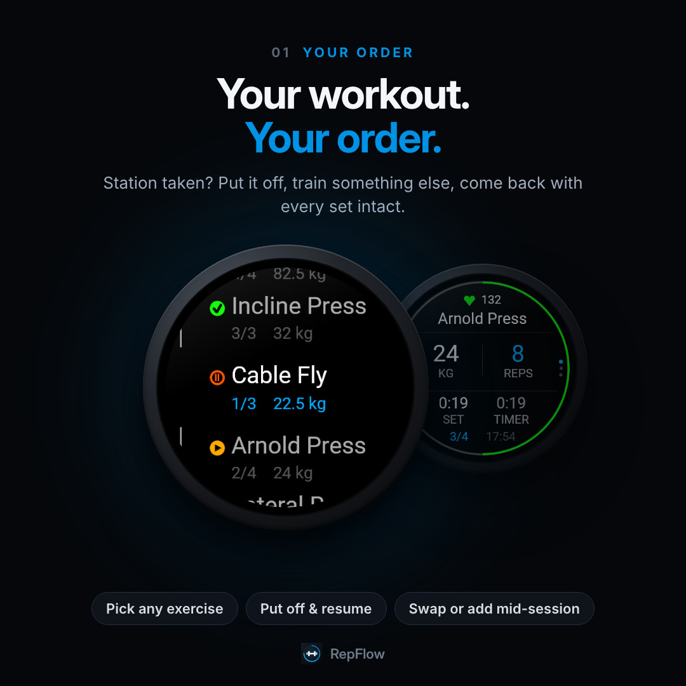 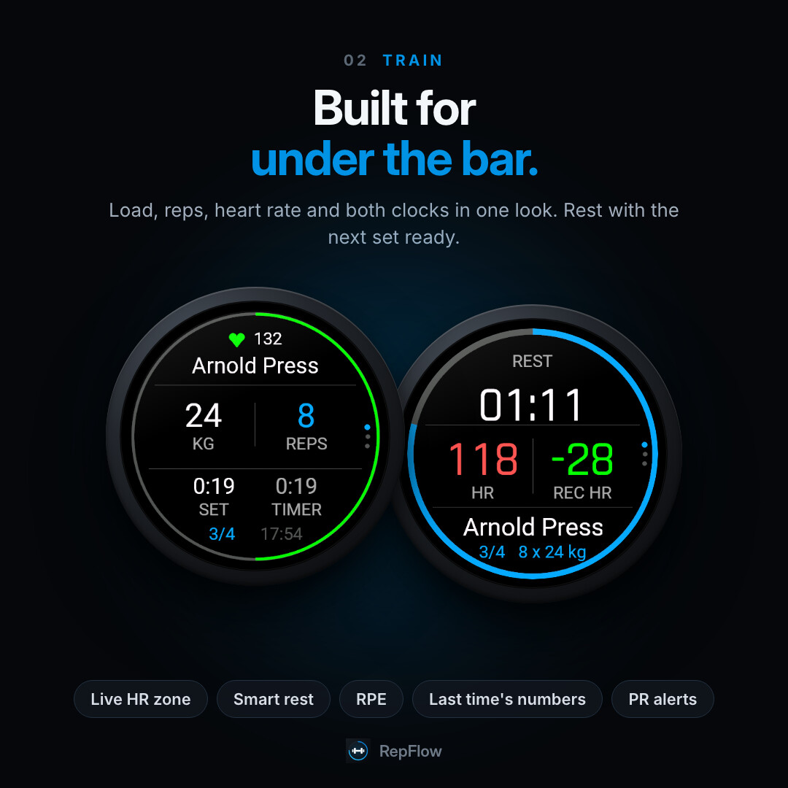 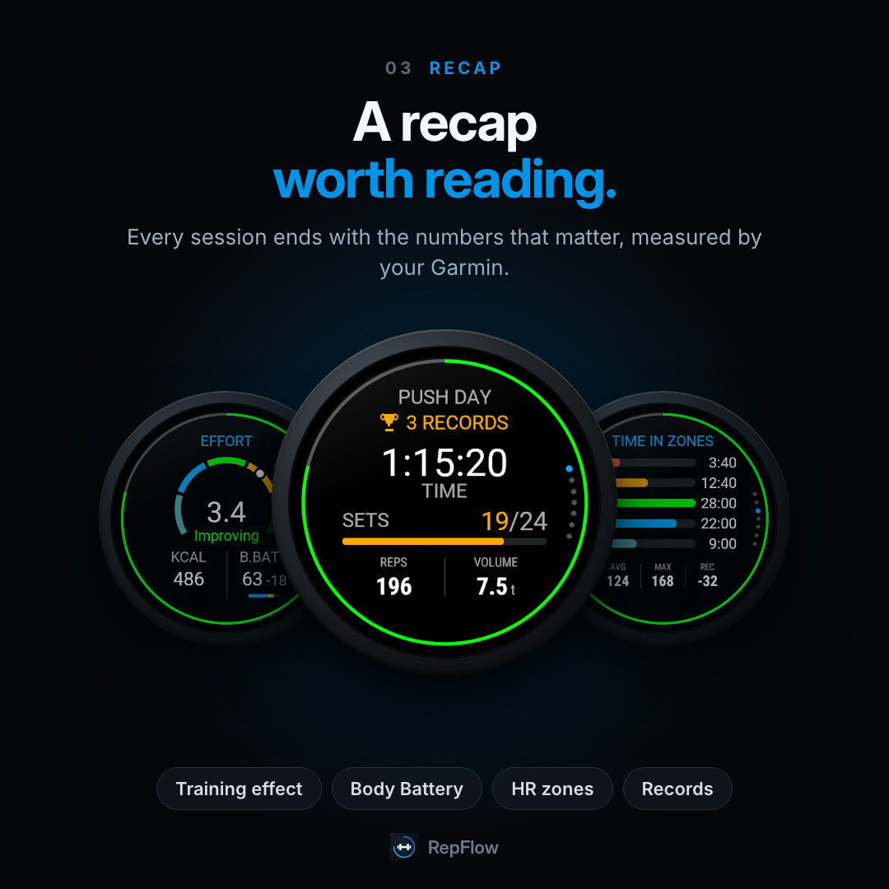
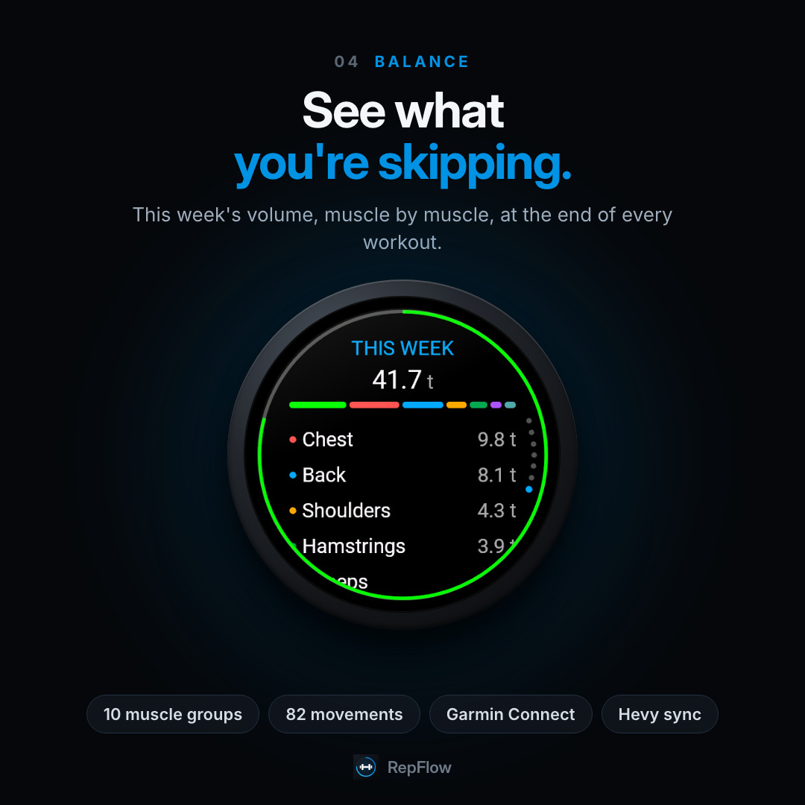 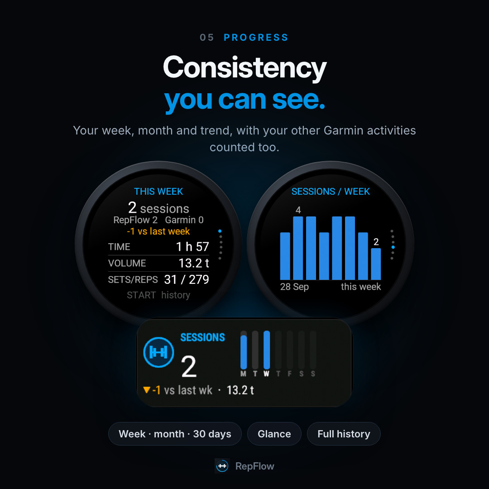

</div>

---

**Contents** —
[The problem](#the-problem) ·
[Install](#install) ·
[User guide](#user-guide) ·
[Settings](#settings) ·
[Hevy sync](#hevy-sync) ·
[Where your workout ends up](#where-your-workout-ends-up) ·
[FAQ](#faq) ·
[Privacy](#privacy) ·
[Building it](#getting-started)

## The problem

You planned bench, then rows, then curls. You get there and somebody is on the
bench for the next twenty minutes.

Your watch does not care. Garmin's own strength mode walks through the workout
in the order it was written, and so does every other strength app on the watch:
do exercise one, then two, then three. Going out of order means fighting the
app — skipping, backing out, losing count, or giving up and typing it into your
phone afterwards.

Real gyms have never worked that way. **RepFlow treats going out of order as
normal, because it is.**

<div align="center">
  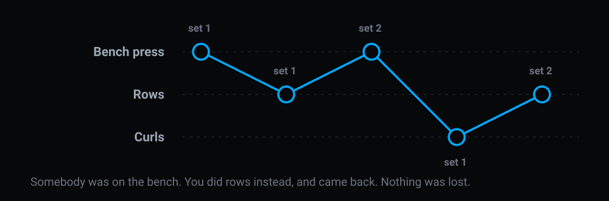
</div>

Pick any exercise at any time. Leave one half-finished and come back to it six
minutes later. Swap a movement for another. Add one that was not in the plan.
Nothing is lost and nothing has to be undone, because the app never assumes
where you are going next.

## Install

1. On your phone, open **Connect IQ Store** (or the Store section of the Garmin
   Connect app) and search for **RepFlow**.
2. Install it on your watch, then sync the watch.
3. On the watch, RepFlow is in your list of activities/apps. Add it to your
   favourites so it is one press away.

Optional: add the **RepFlow glance** to your glance loop to see your week
without opening the app.

### Compatible watches

| Family | Models |
|---|---|
| **Fenix 9 / 9 Pro** | 43, 47 and 51 mm, Pro and Pro Solar |
| **Fenix 8 / 8 Pro** | 43, 47 and 51 mm, AMOLED and Solar |
| **Fenix 7** | 7, 7S, 7X and their Pro versions (with and without Wi-Fi) |
| **Fenix 6 Pro** | 6, 6S, 6 Pro, 6S Pro, 6X Pro |
| **Epix** | Epix 2, Epix Pro 42, 47 and 51 mm |
| **Venu** | Venu 3, Venu 3S |
| **Vivoactive** | Vivoactive 5, Vivoactive 6 |

Not on the list? [Open an issue](https://github.com/cyuss/repflow/issues) and
say which watch.

## User guide

<div align="center">
  
</div>

### 1. Choose a workout

The first screen is your workout list:

- **A saved workout** — your own, or one imported from Hevy.
- **New workout** — start empty and add exercises as you go. 82 movements across
  ten muscle groups, picked by muscle group.
- **Import from Hevy** — brings your Hevy routines to the watch (see
  [Hevy sync](#hevy-sync)).
- **Analytics** — your week, month and history (see [Analytics](#6-analytics-and-the-glance)).

Sets, reps, load, rest and the order of a workout can all be edited on the watch.

### 2. The buttons

Two buttons carry the whole session, and each means one thing the whole way
through. They are the same two Garmin uses on its own activity screens:

| | While you are lifting | While you are resting |
|---|---|---|
| **BACK / LAP** | the set is done | rest is over, back to the bar |
| **START** | show me the exercise list | show me the exercise list |
| **UP / DOWN** | turn the page | turn the page |
| **hold UP** | the menu | the menu |

### 3. Lift a set

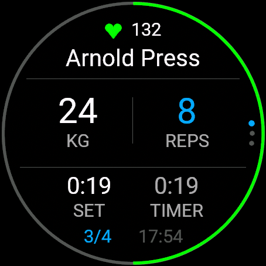

The set screen shows, from top to bottom:

- your **heart rate**, with the live zone gauge around the edge of the screen;
- the **exercise**;
- the **load** and the **reps** to do, pre-filled with what you actually lifted
  last time;
- the **set clock** and the **exercise clock**, and which set you are on (3/4).

Press **LAP** when the set is done. RepFlow shows what is about to be logged —
weight, reps, and how hard it was (RPE). Nothing changed? Press **START** and
it is saved. Eight reps instead of ten? Correct it right there, in two seconds.

A personal record (heaviest set, best estimated 1RM, best volume) gets its own
alert the moment it falls.

<br clear="right">

### 4. Rest

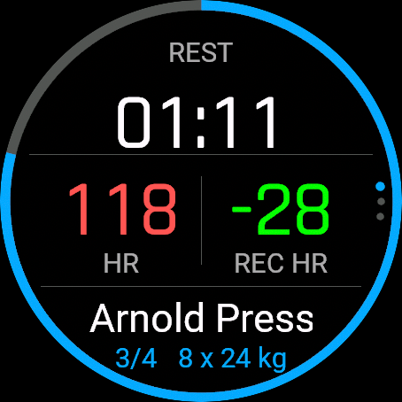

The rest starts by itself after a set:

- a **countdown** (90 s by default), or a clock that runs **until you press**
  — your choice in [Settings](#settings);
- your **heart rate** and its **recovery** since the end of the set (−28 bpm);
- the **next set**, already filled in.

Press **LAP** to get back to the bar, or **START** to go to another exercise.

<br clear="right">

### 5. Change the order — the point of RepFlow

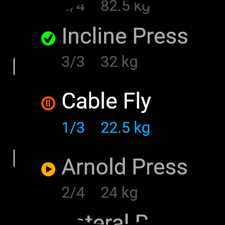

Press **START** at any time for the workout overview: every exercise, how many
sets are done, the load. Pick any one and you are on it.

From the exercise menu (**hold UP**):

- **Skip for now** — the station is taken. The exercise waits, marked
  *Pending*, and resumes exactly where you left it.
- **Substitute** — swap it for another movement, keeping the sets already done.
- **Add a set** — one more than planned.
- **End workout**.

From the overview you can also **Add exercise** to a session already under way.

<br clear="right">

### 6. The recap

When you end the workout, choose **Save** (recorded in Garmin Connect, and sent
to Hevy if you use it) or **Discard** (nothing is kept, nothing is sent). Then
the recap, page by page with **UP / DOWN**:

| Session | Effort | Heart rate zones | Week by muscle |
|:---:|:---:|:---:|:---:|
| 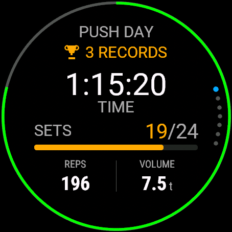 | 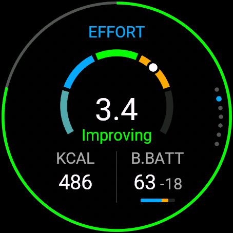 | 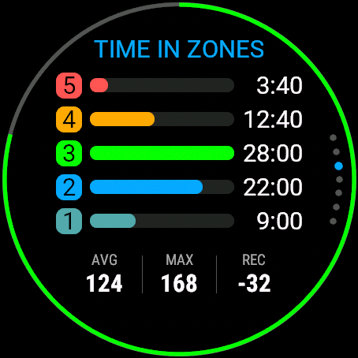 | 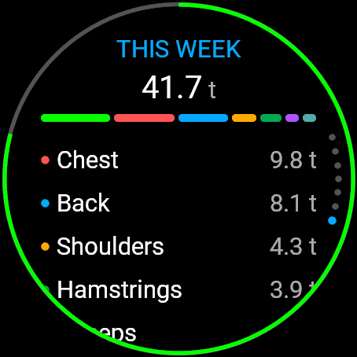 |
| Time, sets done against plan, reps, volume, records | Aerobic training effect, calories, Body Battery and what the session cost | Time in each zone; average, peak and recovery heart rate | This week's volume per muscle group — what you are skipping |

There are also pages for each exercise, effort (RPE) per muscle group, and the
records that fell.

### 7. Analytics and the glance

| This week | Sessions per week | Glance |
|:---:|:---:|:---:|
| 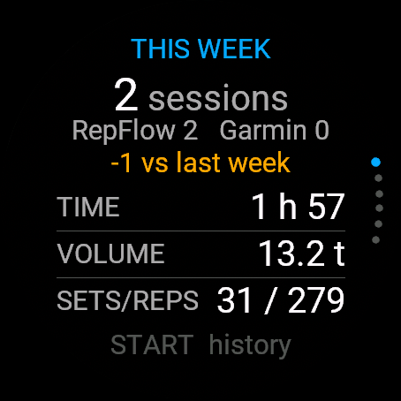 | 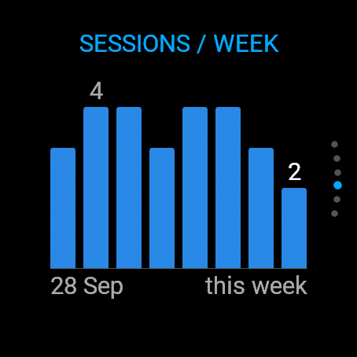 | 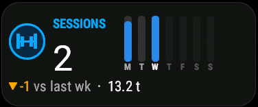 |

**Analytics** (from the workout list) shows your week, your month and the last
30 days — sessions, time, volume, sets and reps, against the period before —
then sessions and volume per week over eight weeks, and your last session.
Press **START** for the full history, filterable by period and source.

Your other Garmin strength activities are counted too, and never twice. Garmin
does not give their loads, so volume is RepFlow's alone.

The **glance** shows your week day by day: sessions this week, against last
week, and the week's volume. Opening RepFlow from the glance goes straight to
Analytics, and **BACK** returns to the glance loop: no workout is started by
accident.

## Settings

On your phone: **Garmin Connect → your watch → Activities & Apps → RepFlow →
Settings**.

| Setting | Default | What it does |
|---|---|---|
| Default rest (seconds) | 90 | Length of the rest countdown (10–900 s) |
| Rest between sets | Countdown | *Countdown*, or *Until I press* |
| Weight step | 1.0 kg | How much one press of UP / DOWN changes the load |
| Weight units | Follow the watch | Kilograms or pounds |
| Vibration | On | Vibrate at the end of a rest and on records |
| Animation | Follow the watch | Screen transitions |
| Background | Black | Black or white |
| Hevy API key | empty | Turns on [Hevy sync](#hevy-sync) |
| Post workouts privately to Hevy | On | Your Hevy workouts stay private |

## Hevy sync

Optional. Without it RepFlow is a complete workout tracker; with it, your
routines and your history move between the two.

1. Hevy requires a **Hevy Pro** account for its API. In Hevy: **Settings →
   Developer** (or [hevy.com/settings?developer](https://hevy.com/settings?developer)),
   and copy your API key.
2. In Garmin Connect, paste it into RepFlow's **Hevy API key** setting.
3. On the watch, in the workout list: **Import from Hevy**. Your routines come
   down to the watch.
4. Every workout you **save** goes up to Hevy on its own, through your phone.
   A workout you discard is never sent. Offline? It is kept and sent later
   (*Unsent workout → Send now*).

> **A Hevy key gives read *and* write access to your whole Hevy history and
> cannot be scoped.** Keep it to yourself. RepFlow sends it to Hevy only.

## Where your workout ends up

<div align="center">
  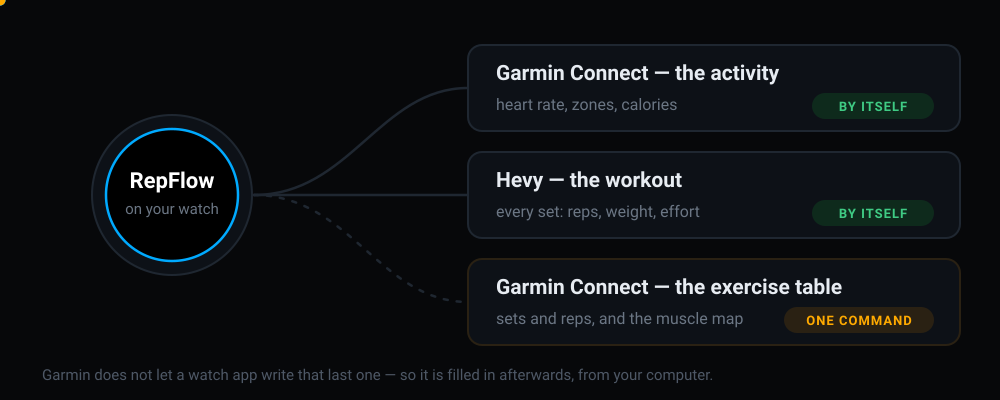
</div>

RepFlow records a **real Garmin activity** — strength training, with heart rate,
zones, calories and training effect. It is in your Garmin history like a run is.

Each set is a **lap**, labelled with the exercise, set, reps and load. You find
them in Garmin Connect, in the activity's laps and its Connect IQ section.

What a watch app cannot fill is the **exercise table** Garmin Connect shows
under a strength activity (and its muscle map): as far as I have been able to
verify, Connect IQ does not let an app write the FIT `set` messages that table
is drawn from. RepFlow fills it in afterwards from a computer, with one command
— see [the table Connect IQ cannot write](#the-table-connect-iq-cannot-write).
The whole investigation, including what does not work, is
[written up here](docs/garmin-strength-integration-poc.md). If you know a way, I
would love to hear it.

## FAQ

**Does it count reps automatically?**
No. Wrist rep counting was too unreliable on heavy compound lifts. Instead the
next set is pre-filled with what you did, and a correction takes two presses.

**Does it work without Hevy?**
Yes, entirely. Hevy is optional.

**Does it work without a phone?**
Yes, during the workout. The phone is only needed to sync to Garmin Connect and
Hevy afterwards, as with any Garmin activity.

**What if the watch crashes or the battery dies mid-workout?**
The session is restored with every set when you open RepFlow again.

**Is it hard on the battery?**
On AMOLED watches nothing is redrawn while the screen is off, and the always-on
screen is redrawn every five seconds rather than every second.

**Why is my Garmin "Sets" tab empty?**
See [Where your workout ends up](#where-your-workout-ends-up): the sets are in
the laps and the Connect IQ section.

**I found a bug / I want a feature.**
[Open an issue](https://github.com/cyuss/repflow/issues). Say which watch.

## Privacy

RepFlow collects nothing: no account, no analytics, no server. Your workouts
stay on your watch, go to Garmin Connect when you save them, and to your own
Hevy account only if you add a key. The full
[privacy policy](store-assets/privacy-policy.md).

## What it does

| | |
|---|---|
| **Any order** | Pick, skip for now, resume, substitute or add an exercise mid-session |
| **A real Garmin activity** | `SPORT_TRAINING` + `SUB_SPORT_STRENGTH_TRAINING` — heart rate, zones, calories, training effect |
| **Hevy, both ways** | Import your routines to the watch; your saved session goes back automatically |
| **Garmin's native exercise table** | Sets, reps and loads into the table Connect IQ cannot write itself (from a computer) |
| **Effort (RPE)** | On the scale Hevy's API accepts, rated after the set, costing no extra press — averaged per muscle group at the end |
| **Rest, two ways** | A countdown, or a clock that runs until you say stop |
| **Recap** | Totals, training effect, Body Battery, time in zone, per-exercise breakdown, RPE per muscle, records, the week's volume by muscle |
| **Analytics and glance** | Week, month, 30 days, eight-week trends, full history; your week on the glance |
| **Battery** | Nothing redrawn while the screen is off |

---

<div align="center">

### Everything below is for building it

</div>

## Getting started

**You need** the [Connect IQ SDK](https://developer.garmin.com/connect-iq/sdk/)
and a Garmin account to download device definitions. The SDK Manager needs a
signed-in account; there is no way around that.

```sh
git clone <your fork>
cd RepFlow

make bootstrap       # SDK, tooling and a developer signing key
make doctor          # check the environment
make test            # 134 watch tests + 300 backend tests
make sim             # run it in the Connect IQ simulator
```

To put it on a watch, connect it over USB and:

```sh
make sideload DEVICE=fenix9pro47mm
```

`make` on its own lists every command with a one-line description, and
`make devices` lists the device ids your SDK has definitions for. Every target
also exists in the `justfile` (`just sim`, `just test`, …).

Useful in the simulator:

```sh
just sim-glance              # the glance, centred, as the watch draws it
DEMO=1 just sim-analytics    # Analytics with a believable demo year
just sim-recap               # the recap of a finished Push Day
just sim-showcase set        # staged workout screens (set | rest | overview)
```

### Your own Hevy key in your own build

Put your key in `secrets/hevy-key.txt` (git-ignored). `make build` then bakes it
into a personal build named `RepFlow-<device>-private.prg`. `make package`
builds the Store bundle **without** it, and checks the `.iq` to make sure.

> **A Hevy key is read *and* write over your entire training history and cannot
> be scoped.** Never commit one. `make doctor` checks that none has been.

## The rule the code follows

> **Select any exercise at any time.**

This sequence is ordinary, not a recovery path:

```
A set 1  →  B set 1  →  A set 2  →  C set 1  →  B set 2
```

There is no cursor. `WorkoutEngine` navigates by stable exercise id and nothing
in the codebase increments an index. Defer an occupied machine, come back to it
six minutes later, and the app has not lost a thing.

## The table Connect IQ cannot write

Garmin Connect draws its exercise table, work/rest split and muscle map from FIT
`set` messages, and **Connect IQ cannot write those** — verified three
independent ways against SDK 9.2.0, and asserted in the test suite so it cannot
rot quietly.

So a RepFlow activity arrives native and its table arrives empty.

`backend/` closes that from the other side. It reads the activity Garmin already
stores, pulls the sets back out of the developer fields RepFlow wrote into the
FIT, and writes them into the same activity as native exercise sets — no second
activity, and the heart rate and calories the watch measured stay untouched.

```sh
make sync-garmin     # fill Garmin Connect's exercise table
make sync-hevy       # post the session to Hevy (the watch usually did it already)
```

It runs on your machine when you ask it to. Nothing is scheduled and nothing
listens.

The idea of mapping exercise names to Garmin's exercise categories, and of
producing the strength data outside the watch, comes from
[hevy2garmin](https://github.com/intergalacticwiseguy/hevy2garmin) by
@intergalacticwiseguy — thank you. The Garmin exercise catalogue itself is
generated from
[python-garminconnect](https://github.com/cyberjunky/python-garminconnect).

## Architecture

```
Views ──▶ AppController ──▶ WorkoutEngine        (pure: imports only Toybox.Lang)
               ├──▶ RestTimer                    (pure, tick-driven)
               ├──▶ GarminRecorder ──▶ ActivityRecording      (the only file that does)
               ├──▶ SessionRepository ──▶ Application.Storage (the only file that does)
               └──▶ HevySync ──▶ HevyApi ──▶ Hevy REST
```

- `WorkoutEngine` is the **single writer** of exercise state. Its class comment
  lists every legal transition.
- Screens are drawn in code, not from XML layouts, so one path covers 240×240
  through 466×466.
- Navigation is flat: `switchToView` everywhere, never a push/pop stack.

More in [`docs/ARCHITECTURE.md`](docs/ARCHITECTURE.md).

## Testing

```sh
make test            # everything
make test-watch      # Monkey C, in the simulator
make test-backend    # Python, no account needed
```

The watch suite runs in the Connect IQ simulator under Run No Evil. The backend
suite is ordinary pytest: the payload builder, the exercise mapping and the FIT
reader are pure functions, and the FIT fixtures are encoded with **Garmin's own**
Python SDK so the reader is checked against Garmin's definition of the format
rather than against its own assumptions.

`backend/tests/test_watch_contract.py` is the one to read first: it parses the
Monkey C source and the resource XML and fails if the two languages ever stop
agreeing about the developer FIT fields.

## Contributing

Read [`CONTRIBUTING.md`](CONTRIBUTING.md) first — particularly the no-fake-API
rule, which is the one thing this project will not bend on: never invent a
class, method, constant or device id. Verify it against the installed SDK, and
record what you found in [`docs/API_LIMITATIONS.md`](docs/API_LIMITATIONS.md).

## Licence

[GNU General Public License v3.0](LICENSE).

You may use, study, modify and redistribute this. If you distribute a modified
version, you must publish its source under the same licence. That is the point:
improvements come back, and nobody turns this into something closed.

## Acknowledgements

- Garmin's [Connect IQ SDK](https://developer.garmin.com/connect-iq/) and its
  published FIT profile.
- [cyberjunky/python-garminconnect](https://github.com/cyberjunky/python-garminconnect)
  (MIT), from which the Garmin exercise catalogue shipped in `backend/` is
  generated — see `backend/scripts/generate_catalogue.py`.
- [hevy2garmin](https://github.com/intergalacticwiseguy/hevy2garmin), which
  demonstrated that a native strength FIT file can be produced outside the
  watch, and is the reason `docs/garmin-strength-integration-poc.md` reaches the
  conclusion it does.

RepFlow is not affiliated with Garmin or with Hevy.
